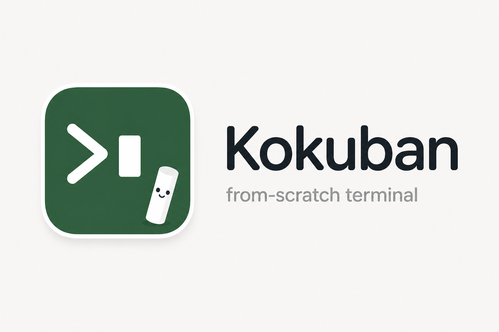
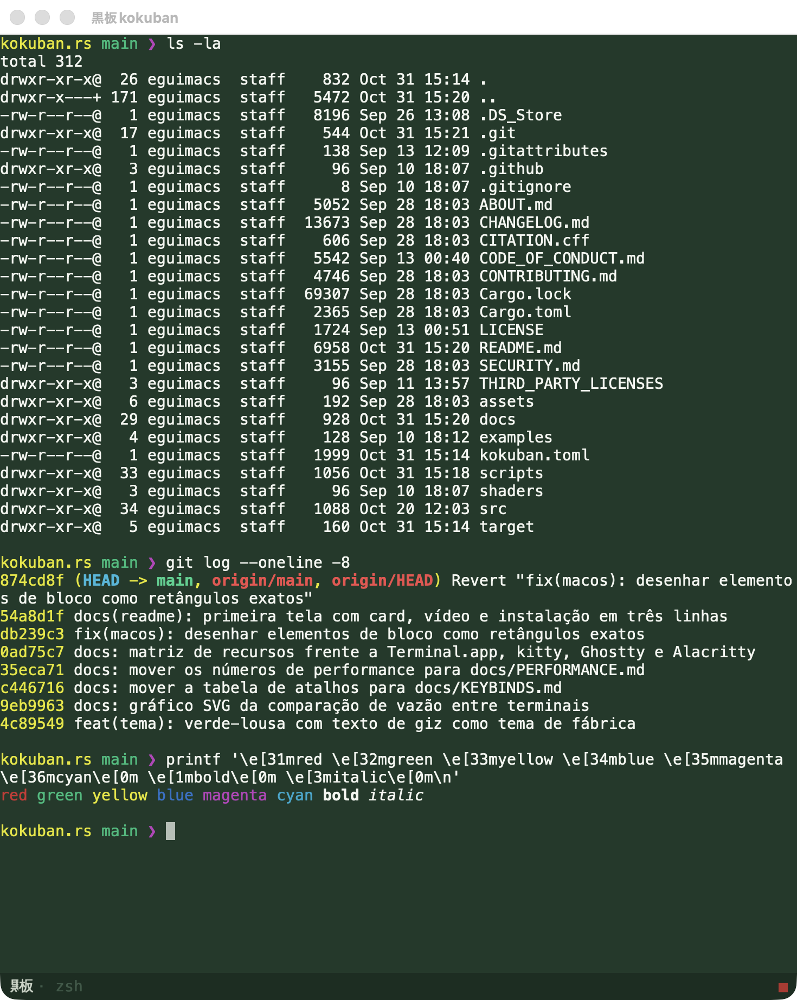
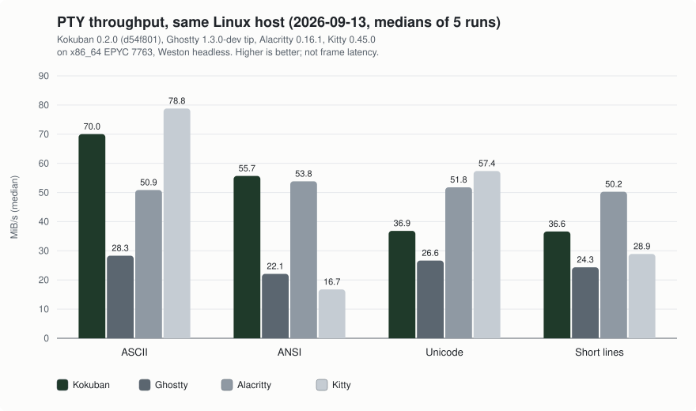

# 黒板 Kokuban



Kokuban is a native Rust terminal for macOS and Linux with its own VT parser, Metal and software rendering, Kitty and Sixel graphics, and a chalkboard theme out of the box.

https://github.com/user-attachments/assets/4769ed61-12ed-4bb9-817f-5f3ee06c3238

[Download v0.4](https://github.com/guicybercode/kokuban.rs/releases/tag/v0.4) · [Docs](docs/INSTALL.md) · [Omarchy](docs/OMARCHY.md) · [Contributing](CONTRIBUTING.md) · [Security](SECURITY.md) · [License](LICENSE)

## Install

**macOS (Apple Silicon)** — for Intel Macs replace `aarch64-apple-darwin` with `x86_64-apple-darwin`:

```sh
curl -LO https://github.com/guicybercode/kokuban.rs/releases/download/v0.4/kokuban-v0.4-aarch64-apple-darwin.dmg
open kokuban-v0.4-aarch64-apple-darwin.dmg
# drag Kokuban to Applications
```

**Linux x86_64** (Ubuntu 24.04 is the tested distribution):

```sh
curl -LO https://github.com/guicybercode/kokuban.rs/releases/download/v0.4/kokuban-v0.4-x86_64-unknown-linux-gnu.tar.gz
tar -xzf kokuban-v0.4-x86_64-unknown-linux-gnu.tar.gz
./kokuban-v0.4-x86_64-unknown-linux-gnu/kokuban
```

Ubuntu runtime dependencies: `sudo apt install --yes libfontconfig1 libfreetype6 fonts-dejavu-core libx11-6 libxcursor1 libx11-xcb1 libxi6 libxkbcommon-x11-0`

**From source** (Rust 1.94.1 via [rustup](https://rustup.rs/)):

```sh
git clone --branch v0.4 --depth 1 https://github.com/guicybercode/kokuban.rs.git && cd kokuban.rs
cargo build --release --locked
./target/release/kokuban
```

**More.** Every release asset has a `.sha256` next to it; check it with `shasum -a 256 --check` (macOS) or `sha256sum --check` (Linux) before opening. The app is ad-hoc signed, so the first launch of `Kokuban.app` may need **Open** from the Finder context menu or approval in Privacy & Security. Later releases install themselves with `kokuban --update`. The release table, build dependencies, troubleshooting, the Linux desktop entry and the image examples are in [docs/INSTALL.md](docs/INSTALL.md).

## Features

- **Native rendering**: Metal GPU renderer on macOS; software rasterizer with winit + softbuffer on Linux.
- **Built-in parser**: own VT/ANSI escape parser with faint, conceal and styled underlines.
- **Text preservation**: complete Unicode graphemes, font fallback, logical-line copy and scrollback reflow on resize.
- **Graphics protocols**: static Kitty PNG/RGB/RGBA images and Sixel on both platforms; bounded native Kitty animation on Linux.
- **Chalkboard theme**: green board, chalk text and one hanko-red accent as the factory default.
- **Omarchy integration (Linux)**: launcher arguments, existing copy/paste shortcuts, live system palette and the system monospace font.
- **Panes, zoom and prompt marks (macOS)**: vim-style splits, per-session font zoom, command-boundary navigation and a status bar.
- **Selection and clipboard**: mouse selection on both platforms; asynchronous system clipboard on Linux.
- **Daily-driver basics**: scrollback search (`Cmd+F`), clickable OSC 8 links, OSC 52 clipboard writes over SSH and tmux, the kitty keyboard protocol for Neovim and Helix, and a per-pane attention mark with `Cmd+Shift+A` to jump to it.
- **Self-update**: `kokuban --update` downloads, verifies and replaces the running release.
- **Configuration**: local or XDG TOML for fonts, colors, images and keybinds.

## Theme

The factory theme is a chalkboard: a `#1f3a2a` green board, `#f4f6f0` chalk text and cursor, chrome in the same green family and hanko red `#b5312c` as the only accent.



```toml
[colors]
foreground = "#f4f6f0"
background = "#1f3a2a"

[selection]
foreground = "#1f3a2a"
background = "#f4f6f0"
```

## Compared with other terminals

Kokuban, Ghostty, Alacritty and Kitty were driven through the same PTY harness on one Linux host; the feature matrix and methodology are in [docs/TERMINAL_COMPARISON.md](docs/TERMINAL_COMPARISON.md).



## Performance

On the same Linux host Kokuban led ANSI throughput at 55.7 MiB/s against Ghostty tip 22.1, Alacritty 53.8 and Kitty 16.7, and beat Ghostty on all four workloads; Kitty led ASCII and Unicode. Full numbers, methods and limits: [docs/PERFORMANCE.md](docs/PERFORMANCE.md).

## Keybinds

Linux clipboard and scrollback inputs, and the configurable macOS pane, zoom and prompt bindings, are listed in [docs/KEYBINDS.md](docs/KEYBINDS.md).

## Configuration

Kokuban reads `kokuban.toml` in the launch directory first, then `$XDG_CONFIG_HOME/kokuban/kokuban.toml` (or `$HOME/.config/kokuban/kokuban.toml`); the first existing file wins and files are not merged. A `kokuban.toml` in the launch directory is honored for appearance, window and keybind settings only: `[notifications] command` and `[images.kitty] allow_file_transfer` are ignored there (with a warning in the log) and are read only from your own `~/.config/kokuban/kokuban.toml`. Invalid or missing configuration falls back to the defaults in `src/config.rs`; see the annotated [kokuban.toml](kokuban.toml) example in the repository root.

```toml
[font]
# family = "DejaVu Sans Mono"  # omit to keep the platform default
size = 14.0

[colors]
foreground = "#f4f6f0"
background = "#1f3a2a"

[selection]
foreground = "#1f3a2a"
background = "#f4f6f0"

[images.kitty]
allow_file_transfer = false
```

## Omarchy

Kokuban works as the Omarchy terminal: `kokuban --working-directory="$HOME" -e nvim`, `xdg-terminal-exec` registration, live palette updates and the system monospace font.
See [docs/OMARCHY.md](docs/OMARCHY.md) for installation and bindings.

## Name

黒板 (*kokuban*) is the Japanese word for "blackboard" or "chalkboard", a blank surface for writing and drawing.

## Status

Kokuban v0.4 (Cargo version 0.4.0) is validated on macOS and Ubuntu 24.04 CI; the exact scope and open items are in the changelog's [validation scope](CHANGELOG.md#validation-scope-and-limits).

## Community and license

Read [CONTRIBUTING.md](CONTRIBUTING.md) for the development workflow and [CODE_OF_CONDUCT.md](CODE_OF_CONDUCT.md) for community expectations. Send vulnerabilities through the private channel in [SECURITY.md](SECURITY.md); ordinary bugs can use [GitHub issues](https://github.com/guicybercode/kokuban.rs/issues). When writing about or building on Kokuban, link to [guicybercode/kokuban.rs](https://github.com/guicybercode/kokuban.rs) and identify the version or commit you used; [CITATION.cff](CITATION.cff) provides citation metadata.

Starting with v0.2, Kokuban's original code and documentation use the [BSD-4-Clause license](LICENSE). Redistributed source and binaries must retain the required copyright notice, conditions and disclaimer. Advertising materials mentioning features or use of the software must display this acknowledgment:

> This product includes software developed by the Kokuban contributors.

Running Kokuban by itself does not require a public announcement. Citation metadata does not replace the license's required notices. The historical v0.1 release remains under its published MIT license. Third-party code, content and assets retain their own licenses, including the derived Unicode tables under MIT and the Contributor Covenant code of conduct under CC-BY-4.0. Release archives include third-party notices. Learn more in [ABOUT.md](ABOUT.md) and [third-party licensing](docs/THIRD_PARTY.md).
